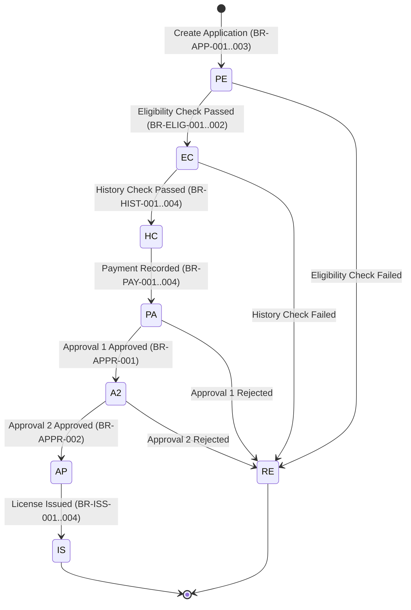

# Business Rules Documentation - Driver License Issuance System (DLIS)

## Table of Contents
1. [Executive Summary](#1-executive-summary)
2. [Domain Overview & Business Vocabulary](#2-domain-overview--business-vocabulary)
3. [Business Rule Catalog](#3-business-rule-catalog)
   - [Candidate Management Rules (BR-CAND-*)](#candidate-management-rules-br-cand-)
   - [Application Lifecycle & State Rules (BR-APP-*)](#application-lifecycle--state-rules-br-app-)
   - [Eligibility Evaluation Rules (BR-ELIG-*)](#eligibility-evaluation-rules-br-elig-)
   - [Driving History & Background Check Rules (BR-HIST-*)](#driving-history--background-check-rules-br-hist-)
   - [Fee Schedule & Payment Processing Rules (BR-PAY-*)](#fee-schedule--payment-processing-rules-br-pay-)
   - [Dual-Level Authority Approval Rules (BR-APPR-*)](#dual-level-authority-approval-rules-br-appr-)
   - [License Issuance & Expiration Rules (BR-ISS-*)](#license-issuance--expiration-rules-br-iss-)
4. [State Transition & Decision Tables](#4-state-transition--decision-tables)
5. [Traceability Matrix](#5-traceability-matrix)

---

## 1. Executive Summary

The **Driver License Issuance System (DLIS)** governs the registration, validation, fee collection, dual-level approval, and issuance of driver licenses. Operating in an enterprise hybrid environment (zLinux / WebSphere Liberty / DB2 / CICS), the system enforces strict statutory regulations and data integrity constraints to ensure that only qualified, lawful candidates are granted driver licenses.

This document serves as the authoritative business rule repository extracted from core service components ([`ApplicationServiceEjb.java`](dlis-core/src/main/java/com/dlis/core/service/ejb/ApplicationServiceEjb.java:1), [`CandidateServiceEjb.java`](dlis-core/src/main/java/com/dlis/core/service/ejb/CandidateServiceEjb.java:1), [`PaymentServiceEjb.java`](dlis-core/src/main/java/com/dlis/core/service/ejb/PaymentServiceEjb.java:1), [`ApprovalServiceEjb.java`](dlis-core/src/main/java/com/dlis/core/service/ejb/ApprovalServiceEjb.java:1)) and DB2 relational constraints ([`DLIS-CREATE-TABLES.sql`](dlis-core/src/main/resources/db2/DLIS-CREATE-TABLES.sql:1)).

---

## 2. Domain Overview & Business Vocabulary

| Business Term | Technical Code / Symbol | Definition |
|---|---|---|
| **Learner License** | `L` | Entry-level driving permit allowing driving under supervised conditions. Minimum age: 16. Valid for 1 year. |
| **Probation License** | `P` | Intermediate driving license allowing solo driving with specific probationary constraints. Minimum age: 17. Valid for 2 years. Requires prior active Learner license. |
| **Open License** | `O` | Full unrestricted driver license. Minimum age: 18. Valid for 5 years. Requires prior active Probation license. |
| **Demerit Points** | Points (0-12) | Penalty points incurred from traffic incidents. Exceeding 12 points results in background check failure and disqualification. Initial balance upon issuance is 12 points. |
| **Dual Approval Workflow** | `A1` & `A2` | Mandatory segregation of duties where a Level 1 Authority officer records initial recommendation, followed by a Level 2 Authority supervisor granting final approval. |
| **Initial Issue Fee** | `IF` | Standard license issuance fee retrieved from active fee schedule. |
| **Vehicle Class** | `A`, `B`, `C`, `D` | Authorized vehicle categories: Class A (Motorcycle), Class B (Passenger Car), Class C (Light Commercial), Class D (Heavy Commercial). |

---

## 3. Business Rule Catalog

### Candidate Management Rules (BR-CAND-*)

#### BR-CAND-001: Unique Identification Number
- **Rule Description:** Every candidate registered in DLIS must possess a globally unique government-issued Identification Number (`ID_NUMBER`).
- **Enforcement:** Service layer ([`CandidateServiceEjb.createCandidate`](dlis-core/src/main/java/com/dlis/core/service/ejb/CandidateServiceEjb.java:32)) queries [`CandidateDao.findByIdNumber`](dlis-core/src/main/java/com/dlis/core/dao/CandidateDao.java:15). Database index `IDX_CAND_IDNUM` supports fast lookup.
- **Failure Action:** Rejection with return code `RC_DUPLICATE` (3) and error message: `"CANDIDATE WITH THIS ID NUMBER ALREADY EXISTS"`.

#### BR-CAND-002: Date of Birth Validity
- **Rule Description:** A candidate's Date of Birth (`DATE_OF_BIRTH`) must be strictly in the past (before current system date).
- **Enforcement:** [`CandidateServiceEjb.createCandidate`](dlis-core/src/main/java/com/dlis/core/service/ejb/CandidateServiceEjb.java:39) and database table check constraint `CHK_CAND_DOB`.
- **Failure Action:** Rejection with return code `RC_INVALID_AGE` (4) and message: `"DATE OF BIRTH MUST BE IN THE PAST"`.

#### BR-CAND-003: Candidate Default Lifecycle Status
- **Rule Description:** Upon initial registration, a candidate record status is set to Active (`'A'`), and created date is stamped with current system date.
- **Enforcement:** [`CandidateServiceEjb.createCandidate`](dlis-core/src/main/java/com/dlis/core/service/ejb/CandidateServiceEjb.java:46).

---

### Application Lifecycle & State Rules (BR-APP-*)

#### BR-APP-001: Active Candidate Pre-requisite
- **Rule Description:** A driver license application can only be created for an existing, active candidate record (`RECORD_STATUS = 'A'`).
- **Enforcement:** [`ApplicationServiceEjb.createApplication`](dlis-core/src/main/java/com/dlis/core/service/ejb/ApplicationServiceEjb.java:45).
- **Failure Action:** Return code `RC_NOT_FOUND` (1), message: `"CANDIDATE NOT FOUND OR INACTIVE"`.

#### BR-APP-002: Valid License Category Code
- **Rule Description:** The requested license type must match one of the statutory category codes: `'L'` (Learner), `'P'` (Probation), or `'O'` (Open).
- **Enforcement:** [`ApplicationServiceEjb.createApplication`](dlis-core/src/main/java/com/dlis/core/service/ejb/ApplicationServiceEjb.java:52), table check constraint `CHK_LICAPP_TYPE`.
- **Failure Action:** Return code `RC_INVALID_TYPE` (4), message: `"INVALID LICENSE TYPE. MUST BE L, P OR O"`.

#### BR-APP-003: Duplicate Active Application Guard
- **Rule Description:** A candidate cannot possess multiple concurrent active applications for the same license type.
- **Enforcement:** [`ApplicationDao.findActiveByCandidate`](dlis-core/src/main/java/com/dlis/core/dao/ApplicationDao.java:23) called by [`ApplicationServiceEjb.createApplication`](dlis-core/src/main/java/com/dlis/core/service/ejb/ApplicationServiceEjb.java:58).
- **Failure Action:** Return code `RC_ALREADY_EXISTS` (3), message: `"AN ACTIVE APPLICATION ALREADY EXISTS FOR THIS LICENSE TYPE"`.

#### BR-APP-004: Strict Sequential Pipeline Execution
- **Rule Description:** An application must progress through the mandatory lifecycle gates in exact sequential order:
  $$\text{PE (Pending)} \xrightarrow{\text{BR-ELIG}} \text{EC (Elig Checked)} \xrightarrow{\text{BR-HIST}} \text{HC (Hist Checked)} \xrightarrow{\text{BR-PAY}} \text{PA (Payment Approved)} \xrightarrow{\text{BR-APPR1}} \text{A2 (Approval 2 Pend)} \xrightarrow{\text{BR-APPR2}} \text{AP (Approved)} \xrightarrow{\text{BR-ISS}} \text{IS (Issued)}$$
- **Enforcement:** Checks in `ApplicationServiceEjb`, `PaymentServiceEjb`, and `ApprovalServiceEjb`.

---

### Eligibility Evaluation Rules (BR-ELIG-*)

#### BR-ELIG-001: Minimum Age Restrictions
- **Rule Description:** Candidates must meet minimum chronological age thresholds on the evaluation date:
  - **Learner (`L`):** Minimum age $\ge 16$ years.
  - **Probation (`P`):** Minimum age $\ge 17$ years.
  - **Open (`O`):** Minimum age $\ge 18$ years.
- **Enforcement:** [`ApplicationServiceEjb.checkEligibility`](dlis-core/src/main/java/com/dlis/core/service/ejb/ApplicationServiceEjb.java:99).
- **Failure Action:** Status set to Rejected (`RE`), eligibility status `'F'`, message indicating age deficit.

#### BR-ELIG-002: Progressive Licensing Hierarchy (Upgrade Path)
- **Rule Description:** To apply for a progressive license tier:
  - Probation (`P`) application requires the candidate to hold an active Learner (`L`) license.
  - Open (`O`) application requires the candidate to hold an active Probation (`P`) license.
  - Learner (`L`) application has no prior license prerequisite.
- **Enforcement:** [`IssuedLicenseDao.findActiveByCandidate`](dlis-core/src/main/java/com/dlis/core/dao/IssuedLicenseDao.java:18) called by [`ApplicationServiceEjb.checkEligibility`](dlis-core/src/main/java/com/dlis/core/service/ejb/ApplicationServiceEjb.java:114).
- **Failure Action:** Eligibility check status `'F'`, application status `'RE'`, message: `"CANDIDATE MUST HOLD AN ACTIVE [LEARNER/PROBATION] LICENSE..."`.

---

### Driving History & Background Check Rules (BR-HIST-*)

#### BR-HIST-001: Prerequisite Eligibility Clearance
- **Rule Description:** A driving history check can only be executed if the application has already passed the eligibility check (`ELIGIBILITY_CHK_STATUS = 'P'`).
- **Enforcement:** [`ApplicationServiceEjb.checkHistory`](dlis-core/src/main/java/com/dlis/core/service/ejb/ApplicationServiceEjb.java:150).
- **Failure Action:** Error return code 2, message: `"ELIGIBILITY CHECK MUST BE PASSED BEFORE HISTORY CHECK"`.

#### BR-HIST-002: Active Suspension or Disqualification Prohibition
- **Rule Description:** If a candidate has any active driving suspension (`INCIDENT_TYPE = 'SU'`) or court disqualification (`INCIDENT_TYPE = 'DQ'`) with no suspension end date or an end date $\ge$ current date, the history check must fail.
- **Enforcement:** [`DrivingHistory.isActiveSuspensionOrDisqualification`](dlis-core/src/main/java/com/dlis/core/domain/DrivingHistory.java:108) evaluated in [`ApplicationServiceEjb.checkHistory`](dlis-core/src/main/java/com/dlis/core/service/ejb/ApplicationServiceEjb.java:161).
- **Failure Action:** History status `'F'`, application status `'RE'`, message: `"CANDIDATE IS UNDER AN ACTIVE SUSPENSION OR DISQUALIFICATION"`.

#### BR-HIST-003: Outstanding Unpaid Fines
- **Rule Description:** If a candidate has any active traffic citation where fine amount $> 0$ and fine paid status is `'N'`, the history check must fail.
- **Enforcement:** [`DrivingHistory.hasUnpaidFine`](dlis-core/src/main/java/com/dlis/core/domain/DrivingHistory.java:115) evaluated in [`ApplicationServiceEjb.checkHistory`](dlis-core/src/main/java/com/dlis/core/service/ejb/ApplicationServiceEjb.java:169).
- **Failure Action:** History status `'F'`, application status `'RE'`, message: `"CANDIDATE HAS OUTSTANDING UNPAID FINES"`.

#### BR-HIST-004: Maximum Cumulative Demerit Threshold
- **Rule Description:** The total accumulated demerit points across all active driving history records must not exceed 12 points ($\sum \text{points} \le 12$).
- **Enforcement:** [`ApplicationServiceEjb.checkHistory`](dlis-core/src/main/java/com/dlis/core/service/ejb/ApplicationServiceEjb.java:174).
- **Failure Action:** History status `'F'`, application status `'RE'`, message: `"TOTAL DEMERIT POINTS EXCEED ALLOWABLE THRESHOLD OF 12"`.

---

### Fee Schedule & Payment Processing Rules (BR-PAY-*)

#### BR-PAY-001: Prerequisite History Clearance
- **Rule Description:** Payment can only be processed if the driving history check has been successfully passed (`HISTORY_CHK_STATUS = 'P'`).
- **Enforcement:** [`PaymentServiceEjb.processPayment`](dlis-core/src/main/java/com/dlis/core/service/ejb/PaymentServiceEjb.java:48).
- **Failure Action:** Return code `RC_HISTORY_NOT_PASSED` (2), message: `"HISTORY CHECK MUST BE PASSED BEFORE PAYMENT"`.

#### BR-PAY-002: Single Payment Execution (Idempotency)
- **Rule Description:** An application cannot be paid more than once. If `PAYMENT_STATUS = 'P'`, further payment attempts are rejected.
- **Enforcement:** [`PaymentServiceEjb.processPayment`](dlis-core/src/main/java/com/dlis/core/service/ejb/PaymentServiceEjb.java:54).
- **Failure Action:** Return code `RC_ALREADY_PAID` (3), message: `"PAYMENT HAS ALREADY BEEN RECORDED FOR THIS APPLICATION"`.

#### BR-PAY-003: Statutory Fee Lookup
- **Rule Description:** Fee amount is retrieved dynamically from the active `LICENSE_FEE_SCHEDULE` for the matching `LICENSE_TYPE` and fee type `'IF'` (Issue Fee).
- **Default Seed Rates:**
  - Learner (`L`): $45.00 USD
  - Probation (`P`): $75.00 USD
  - Open (`O`): $95.00 USD
- **Enforcement:** [`LicenseFeeScheduleDao.findActiveFee`](dlis-core/src/main/java/com/dlis/core/dao/LicenseFeeScheduleDao.java:19) called by [`PaymentServiceEjb.processPayment`](dlis-core/src/main/java/com/dlis/core/service/ejb/PaymentServiceEjb.java:60).

#### BR-PAY-004: Receipt Number Format
- **Rule Description:** Upon payment confirmation, the system generates a standardized receipt number matching the pattern:
  $$\text{Receipt Number} = \text{"RCP"} + \text{YYYYMMDD} + \text{APPLICATION\_ID}$$
- **Enforcement:** [`PaymentServiceEjb.processPayment`](dlis-core/src/main/java/com/dlis/core/service/ejb/PaymentServiceEjb.java:68).

---

### Dual-Level Authority Approval Rules (BR-APPR-*)

#### BR-APPR-001: Level 1 Officer Authorization
- **Rule Description:** First approval requires an active user in `AUTHORITY_USER` with `AUTHORITY_LEVEL = '1'` who is explicitly authorized for the application's license type (`LICENSE_TYPES_AUTHORISED` contains `'L'`, `'P'`, or `'O'`).
- **Payment Prerequisite:** `PAYMENT_STATUS` must be `'P'`.
- **Enforcement:** [`ApprovalServiceEjb.recordApproval1`](dlis-core/src/main/java/com/dlis/core/service/ejb/ApprovalServiceEjb.java:54).
- **Transitions:** Decision `'A'` $\rightarrow$ Application Status `A2`; Decision `'R'` $\rightarrow$ Status `RE`.

#### BR-APPR-002: Level 2 Supervisor Authorization
- **Rule Description:** Second approval requires an active user in `AUTHORITY_USER` with `AUTHORITY_LEVEL = '2'` authorized for the license type.
- **Workflow Prerequisite:** Application must be in status `A2` (First Approval Granted).
- **Enforcement:** [`ApprovalServiceEjb.recordApproval2`](dlis-core/src/main/java/com/dlis/core/service/ejb/ApprovalServiceEjb.java:103).
- **Transitions:** Decision `'A'` $\rightarrow$ Application Status `AP`; Decision `'R'` $\rightarrow$ Status `RE`.

---

### License Issuance & Expiration Rules (BR-ISS-*)

#### BR-ISS-001: Full Pre-issuance Verification
- **Rule Description:** A license can only be issued if the application satisfies all four criteria:
  1. `APPLICATION_STATUS = 'AP'` (Fully Approved)
  2. `ELIGIBILITY_CHK_STATUS = 'P'` (Passed)
  3. `HISTORY_CHK_STATUS = 'P'` (Passed)
  4. `PAYMENT_STATUS = 'P'` (Paid)
- **Enforcement:** [`ApprovalServiceEjb.issueLicense`](dlis-core/src/main/java/com/dlis/core/service/ejb/ApprovalServiceEjb.java:151).

#### BR-ISS-002: License Number Generation Pattern
- **Rule Description:** Unique license number generated as:
  $$\text{License Number} = \text{PREFIX} + \text{VEHICLE\_CLASS} + \text{CANDIDATE\_ID} + \text{APPLICATION\_ID}$$
  where $\text{PREFIX} \in \{\text{"LRN"}, \text{"PRB"}, \text{"OPN"}\}$ based on license type.

#### BR-ISS-003: Expiration Period Rules
- **Rule Description:** License expiration is calculated from issue date:
  - **Learner (`L`):** 1 year ($\text{Issue Date} + 1\text{ year}$)
  - **Probation (`P`):** 2 years ($\text{Issue Date} + 2\text{ years}$)
  - **Open (`O`):** 5 years ($\text{Issue Date} + 5\text{ years}$)
- **Enforcement:** [`ApprovalServiceEjb.issueLicense`](dlis-core/src/main/java/com/dlis/core/service/ejb/ApprovalServiceEjb.java:166).

#### BR-ISS-004: Initial Demerit Point Allocation
- **Rule Description:** Newly issued driver licenses are initialized with a standard full demerit point balance of 12 points (`DEMERIT_BALANCE = 12`).
- **Enforcement:** [`ApprovalServiceEjb.issueLicense`](dlis-core/src/main/java/com/dlis/core/service/ejb/ApprovalServiceEjb.java:189).

---

## 4. State Transition & Decision Tables

### License Application Status Matrix

---

## 5. Traceability Matrix

| Rule ID | Business Function | Implementing Class & Method | Database Constraints |
|---|---|---|---|
| **BR-CAND-001** | Unique Candidate ID Number | [`CandidateServiceEjb.createCandidate`](dlis-core/src/main/java/com/dlis/core/service/ejb/CandidateServiceEjb.java:32) | `IDX_CAND_IDNUM` |
| **BR-CAND-002** | DOB in Past | [`CandidateServiceEjb.createCandidate`](dlis-core/src/main/java/com/dlis/core/service/ejb/CandidateServiceEjb.java:39) | `CHK_CAND_DOB` |
| **BR-APP-001** | Active Candidate Check | [`ApplicationServiceEjb.createApplication`](dlis-core/src/main/java/com/dlis/core/service/ejb/ApplicationServiceEjb.java:45) | `FK_LICAPP_CAND` |
| **BR-APP-002** | Valid License Type | [`ApplicationServiceEjb.createApplication`](dlis-core/src/main/java/com/dlis/core/service/ejb/ApplicationServiceEjb.java:52) | `CHK_LICAPP_TYPE` |
| **BR-APP-003** | Duplicate App Guard | [`ApplicationServiceEjb.createApplication`](dlis-core/src/main/java/com/dlis/core/service/ejb/ApplicationServiceEjb.java:58) | `IDX_APP_TYPE` |
| **BR-ELIG-001** | Age Evaluation | [`ApplicationServiceEjb.checkEligibility`](dlis-core/src/main/java/com/dlis/core/service/ejb/ApplicationServiceEjb.java:99) | `CHK_ELIG_STATUS` |
| **BR-ELIG-002** | Upgrade Tier Path | [`ApplicationServiceEjb.checkEligibility`](dlis-core/src/main/java/com/dlis/core/service/ejb/ApplicationServiceEjb.java:114) | `IDX_ISSLOC_TYPE` |
| **BR-HIST-001..004**| History Checks & Demerits| [`ApplicationServiceEjb.checkHistory`](dlis-core/src/main/java/com/dlis/core/service/ejb/ApplicationServiceEjb.java:142) | `CHK_HIST_STATUS` |
| **BR-PAY-001..004** | Payment & Receipting | [`PaymentServiceEjb.processPayment`](dlis-core/src/main/java/com/dlis/core/service/ejb/PaymentServiceEjb.java:35) | `CHK_PAY_STATUS`, `CHK_PAY_AMOUNT` |
| **BR-APPR-001..002**| Dual Authority Signoff | [`ApprovalServiceEjb.recordApproval1/2`](dlis-core/src/main/java/com/dlis/core/service/ejb/ApprovalServiceEjb.java:39) | `CHK_APP1_STATUS`, `CHK_APP2_STATUS` |
| **BR-ISS-001..004** | License Generation | [`ApprovalServiceEjb.issueLicense`](dlis-core/src/main/java/com/dlis/core/service/ejb/ApprovalServiceEjb.java:136) | `UQ_LIC_NUMBER`, `CHK_LIC_EXPIRY` |
