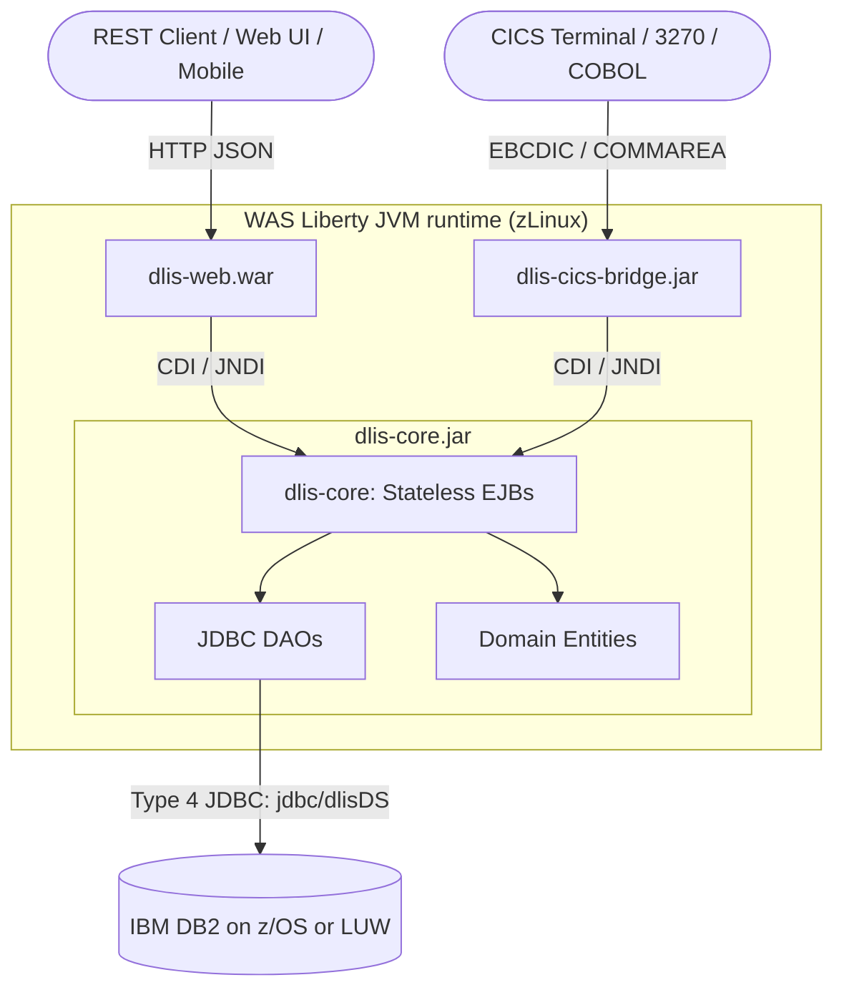
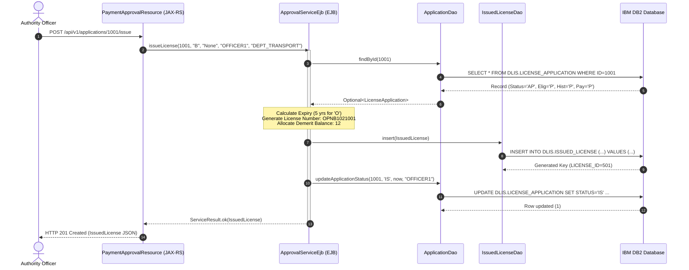

# Program Architecture Documentation - DLIS

## 1. System Overview

The **Driver License Issuance System (DLIS)** is an enterprise Java modernization architecture hosted on **IBM zLinux** executing on **IBM WebSphere Application Server (WAS) Liberty**. It bridges modern HTTP REST / JSON interfaces with transactional **CICS Transaction Server** programs and an **IBM DB2** relational datastore.

---

## 2. Module Decomposition

### 2.1 `dlis-core` (Domain Model, Services, DAOs)
- **Packaging:** JAR
- **Purpose:** Encapsulates the core business models, stateless EJB service layer, and JDBC data access objects.
- **Key Packages:**
  - `com.dlis.core.domain`: Rich entity POJOs with domain validation helper methods ([`LicenseApplication`](dlis-core/src/main/java/com/dlis/core/domain/LicenseApplication.java:1), [`Candidate`](dlis-core/src/main/java/com/dlis/core/domain/Candidate.java:1), [`Payment`](dlis-core/src/main/java/com/dlis/core/domain/Payment.java:1), [`IssuedLicense`](dlis-core/src/main/java/com/dlis/core/domain/IssuedLicense.java:1), [`DrivingHistory`](dlis-core/src/main/java/com/dlis/core/domain/DrivingHistory.java:1), [`AuthorityUser`](dlis-core/src/main/java/com/dlis/core/domain/AuthorityUser.java:1), [`LicenseFeeSchedule`](dlis-core/src/main/java/com/dlis/core/domain/LicenseFeeSchedule.java:1)).
  - `com.dlis.core.service`: Service interfaces ([`ApplicationService`](dlis-core/src/main/java/com/dlis/core/service/ApplicationService.java:1), [`CandidateService`](dlis-core/src/main/java/com/dlis/core/service/CandidateService.java:1), [`PaymentService`](dlis-core/src/main/java/com/dlis/core/service/PaymentService.java:1), [`ApprovalService`](dlis-core/src/main/java/com/dlis/core/service/ApprovalService.java:1), [`ServiceResult`](dlis-core/src/main/java/com/dlis/core/service/ServiceResult.java:1)).
  - `com.dlis.core.service.ejb`: Enterprise Java Bean implementations annotated with `@Stateless` and `@TransactionAttribute(REQUIRED)`.
  - `com.dlis.core.dao` & `dao.jdbc`: Data access interfaces and implementations utilizing standard JDBC connected to `jdbc/dlisDS`.

### 2.2 `dlis-cics-bridge` (CICS JCICS Program Adapters)
- **Packaging:** JAR
- **Purpose:** Implements IBM JCICS `Executable` interfaces and binary byte-oriented COMMAREA serializers/deserializers for mainframe interoperability.
- **Key Components:**
  - `com.dlis.cics.commarea.BaseCommarea`: Abstract 108-byte header structure supporting standardized return codes, error messages, and transaction IDs.
  - `com.dlis.cics.commarea.ApplicationCommarea`: Extended 160-byte buffer for application inquiry and creation.
  - `com.dlis.cics.commarea.CandidateCommarea`: Extended 360-byte buffer for candidate registration.
  - `com.dlis.cics.program.DlisCandProgram`: CICS program `DLISCAND` (Transaction `CAND`).
  - `com.dlis.cics.program.DlisApplProgram`: CICS program `DLISAPPL` (Transaction `APPL`).
  - `com.dlis.cics.program.DlisPayApprProgram`: CICS program `DLISPAAP` (Transaction `PAAP`).

### 2.3 `dlis-web` (JAX-RS 2.1 REST API)
- **Packaging:** WAR
- **Context Root:** `/dlis/api/v1`
- **Key Components:**
  - `com.dlis.web.rest.DlisApplication`: JAX-RS application activator (`@ApplicationPath("/api/v1")`).
  - `com.dlis.web.rest.CandidateResource`: Endpoints for candidate onboarding and lookup.
  - `com.dlis.web.rest.ApplicationResource`: Endpoints for application lifecycle management and checks.
  - `com.dlis.web.rest.PaymentApprovalResource`: Endpoints for payments, approvals, and issuance.

### 2.4 `dlis-ear` (Enterprise Application Archive)
- **Packaging:** EAR
- **Liberty Configuration:** Configures JAX-RS 2.1, EJB Lite 3.2, CDI 2.0, JDBC 4.2 features, JNDI dataSource `jdbc/dlisDS`, and security roles.

---

## 3. Component Interaction Sequence

